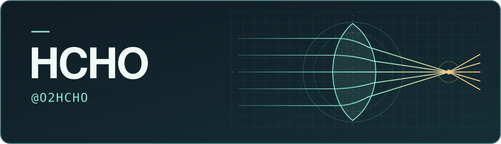

## 图像工具、光学与机器人

我做过漫画批量上色工具、把二维图案变成透镜模型的生成器，也在尝试写六足机器人的程序。

### 作品

**[image2-comics · 漫画上色工作台](https://github.com/O2HCHO/image2-comics)** Windows 桌面工具，支持参考图配色、批量上色、原图与结果对照，以及失败后续跑。 `Python` · `图像处理`

**[Caustic-lens · 焦散透镜生成器](https://github.com/O2HCHO/Caustic-lens)** 用二维目标图案生成自由曲面透镜模型，预览光强和网格，并导出 STL。 `Python` · `Streamlit` · `计算光学`

**[Hexapod · 六足机器人](https://github.com/O2HCHO/Hexapod)** 用 C++ 和 PlatformIO 编写六足机器人程序的实验项目。 `C++` · `PlatformIO`

### 笔记

[my-notes](https://github.com/O2HCHO/my-notes) 收录我的学习和生活笔记。
